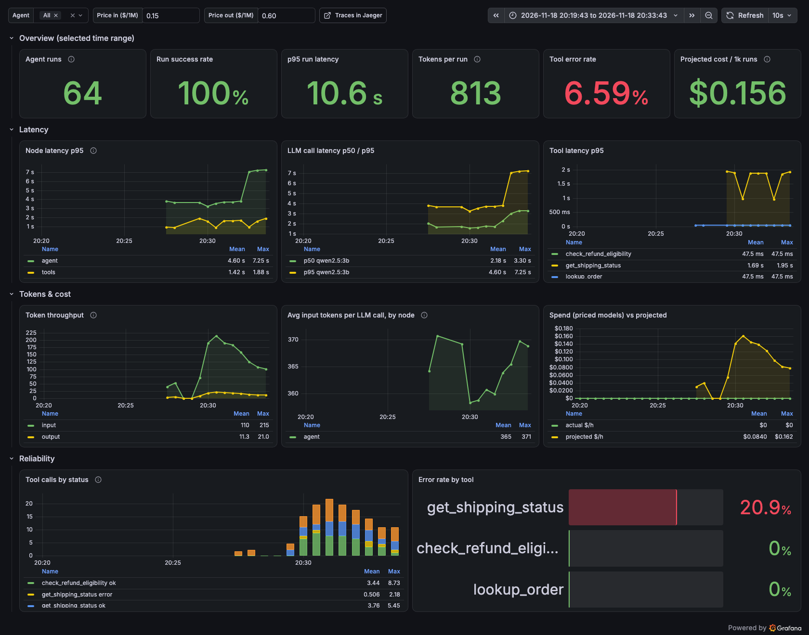
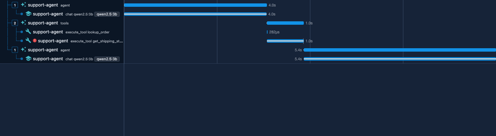
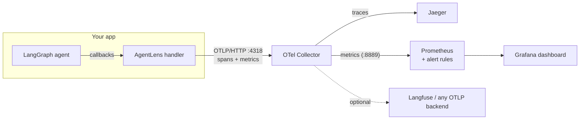

# AgentLens

**OpenTelemetry tracing, cost and latency metrics for LangGraph / LangChain agents, in three lines of code.**

Getting an agent demo working is easy. Knowing *why* run #4,812 took 40 seconds, which tool keeps failing, or why
this week's token bill doubled is not. AgentLens turns every graph node, LLM call, retrieval and tool call into an
OpenTelemetry span with the [GenAI semantic conventions](https://opentelemetry.io/docs/specs/semconv/gen-ai/), emits
latency / token / cost / error metrics, and ships a ready-made Grafana dashboard and Prometheus alert rules.

```python
import agentlens

agentlens.configure(service_name="support-agent")                 # OTLP -> collector
app = agentlens.instrument(graph.compile(), agent_name="support-agent")
app.invoke({"messages": [("user", "Where is my order A1001?")]})   # traced
```


*Real data: 65 runs of the demo support agent on a local Qwen2.5-3B model (Ollama, 8 GB M1 Mac).*


*One run in Jaeger: agent → tools → agent. The carrier API call failed (red) and the agent recovered on the next turn.*

## What you get

| | |
|---|---|
| **Traces** | `invoke_agent` → node → `chat <model>` / `execute_tool <tool>` / `retrieval <source>` span tree, with model, tokens, cost, finish reason, tool errors and (opt-in) prompts and completions |
| **Metrics** | `gen_ai.client.operation.duration`, `gen_ai.client.token.usage` (semconv) plus per-node latency, per-tool calls/errors/latency, per-run duration and cost |
| **Dashboard** | 18-panel Grafana dashboard: runs, success rate, p95 latency, tokens per run, tool error rate, cost per 1k runs, latency by node / model / tool, context growth per node |
| **Alerts** | Tool error rate > 5%, p95 run latency > 30 s, failing runs > 2%, token burn per run, projected daily spend |
| **Cost** | Built-in price table (Claude, GPT families) with prefix matching for dated model IDs and cache-read pricing; override with `register_price()` |
| **Any model** | Works with any LangChain chat model: OpenAI, Anthropic, Bedrock, Ollama, vLLM… The demo runs fully local |

## Architecture



AgentLens is a LangChain `BaseCallbackHandler`, so it needs no changes to your graph. Plumbing runnables
(`RunnableSequence`, `ChannelWrite`, branch functions) get no spans of their own: their children are attached to the
nearest real ancestor, so traces read like the graph you drew, not like LangChain internals.

## Quick start (fully local, no API keys)

Prerequisites: Docker (Docker Desktop, OrbStack or Colima) and [Ollama](https://ollama.com).

```bash
git clone https://github.com/FardeenK29/agentlens && cd agentlens
docker compose up -d                      # Collector, Jaeger, Prometheus, Grafana
ollama pull qwen2.5:3b
python -m venv .venv && source .venv/bin/activate
pip install -e ".[demo]" langchain-ollama
python examples/run_demo.py --runs 30     # e-commerce support agent with 3 tools
```

| UI | URL |
|---|---|
| Grafana dashboard | http://localhost:3000 |
| Jaeger traces | http://localhost:16686 |
| Prometheus alerts | http://localhost:9090/alerts |

To use a hosted model instead: `MODEL=openai:gpt-4o-mini python examples/run_demo.py` (any `init_chat_model` string).

The demo's `get_shipping_status` tool deliberately sleeps 0.2–1.5 s and fails ~12% of the time
(`DEMO_TOOL_FAILURE_RATE`), so the latency and error panels have something real to show.

## Using it in your project

```python
import agentlens

# 1. Point at your collector (or skip this if your app already configures OpenTelemetry)
agentlens.configure(service_name="billing-agent", endpoint="http://otel-collector:4318")

# 2a. Wrap a compiled graph / runnable ...
app = agentlens.instrument(graph.compile(), agent_name="billing-agent")

# 2b. ... or pass the handler per call
handler = agentlens.callback_handler("billing-agent")
graph.invoke(inputs, config={"callbacks": [handler]})

# Prices for models not in the built-in table (USD per 1M tokens)
agentlens.register_price("my-finetune", input=0.30, output=1.20)
```

**Privacy:** prompt and completion text is **not** recorded unless you pass `capture_content=True` (or set
`AGENTLENS_CAPTURE_CONTENT=true`). The collector config also includes a commented `attributes/redact` processor that
strips message content centrally, whatever the app does.

## Span attributes

| Span | Key attributes |
|---|---|
| `invoke_agent <name>` | `gen_ai.agent.name`, `gen_ai.conversation.id` (LangGraph `thread_id`), `agentlens.run.cost.usd`, `agentlens.run.llm_calls`, `agentlens.run.tool_calls` |
| `<node>` | `agentlens.node`, `agentlens.step` |
| `chat <model>` | `gen_ai.provider.name`, `gen_ai.request.model`, `gen_ai.response.model`, `gen_ai.usage.input_tokens` / `output_tokens` / `cache_read.input_tokens`, `gen_ai.response.finish_reasons`, `agentlens.cost.usd` |
| `execute_tool <tool>` | `gen_ai.tool.name`, `gen_ai.tool.call.id`, `error.type`, (opt-in) `gen_ai.tool.call.arguments` / `result` |
| `retrieval <retriever>` | `gen_ai.data_source.id`, `agentlens.retrieval.documents` |

## Demo results (measured)

From the run shown in the screenshots: 65 runs, Qwen2.5-3B on an 8 GB M1 via Ollama.

| Metric | Value |
|---|---|
| Run success rate | 100% (the agent recovered from every tool failure) |
| p95 run latency | 10.6 s |
| LLM call latency p50 / p95 | 2.2 s / 4.6 s (mean over the window) |
| Tokens per run | 813 |
| Tool error rate | 6.6% overall, 20.9% on `get_shipping_status` (injected faults, 12% configured) |
| Projected cost per 1k runs | $0.16 at $0.15 / $0.60 per 1M tokens (the local model itself costs $0) |

## Tests

```bash
pip install -e ".[dev]" && pytest
```

The tests build a real LangGraph graph with a scripted fake model and assert the span tree, parent/child links, token
and cost maths, metric values, error status on failing tools, and that content is not captured by default.

## Roadmap

- Async-safe context propagation for user spans created inside nodes
- Streaming: time-to-first-token metric
- OpenAI Agents SDK and CrewAI adapters

## License

MIT
